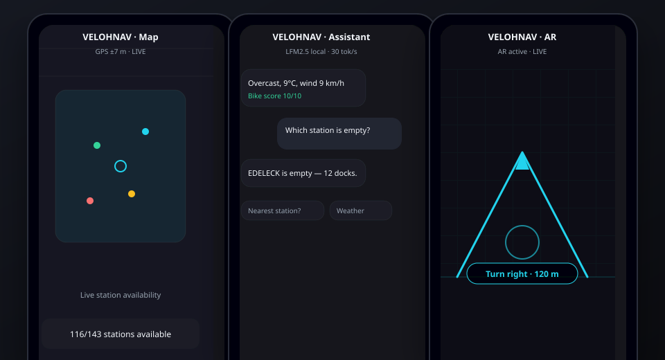

# VelohNav

**Local AI bike assistant for the Vel'OH! network in Luxembourg.**

[](https://github.com/Silexperience210/velohnav/actions/workflows/apk.yml)


[🎬 Open the motion showcase](docs/showcase.html)

---

## What it is

VelohNav is a privacy-first Android app for cyclists in Luxembourg. It combines a live map of Vel'OH! stations, an on-device AI assistant, AR turn-by-turn navigation, weather-aware ride advice, and public-transport departures — without sending your location or questions to the cloud.



---

## Features

### 🗺️ Live station map
- Real-time bikes, e-bikes and free docks from GBFS.
- Filters: available bikes, free docks, electric.
- Search by station name.
- Tap a station to start AR navigation or a trip.

### 🤖 Local AI assistant
- **LFM2.5 runs on the phone** (native CPU, ~30 tokens/s, ~1.2 s load).
- Ask in English or French: "Nearest station?", "Which station is empty?", "Weather?", "Route to Kirchberg", "Next bus?".
- Numbers and facts always come from app data, never from the model's imagination.
- A fallback deterministic engine answers even when the model is unavailable.

### 🥽 AR navigation
- Camera overlay with turn-by-turn directions.
- Compass + GPS fusion.
- Picks the best walking or cycling route from your location.

### 🌦️ Weather-aware advice
- Current conditions and hourly forecast.
- A simple bike score tells you if it's a good moment to ride.
- Automatic multimodal suggestion when the weather degrades.

### 🚌 Bus & tram departures
- Real-time departures from Transitous (MOTIS / ATP Luxembourg).
- Mixed-mode routing: bike to a station, then public transport.

### 🔒 100 % private
- No cloud LLM.
- No tracking.
- No account required.
- Optional Lightning rewards are paid directly to your wallet via LNURL-pay.

---

## Motion showcase

Open `docs/showcase.html` in a browser for a 42-second animated tour of the app:

```bash
open docs/showcase.html        # macOS
xdg-open docs/showcase.html    # Linux
```

---

## Tech stack

| Layer | Technology |
|-------|------------|
| UI | React 18 + Vite 5 |
| Mobile bridge | Capacitor 8 |
| Map | MapLibre GL + OpenFreeMap |
| Local model | LFM2.5 via transformers.js + custom native CPU backend (C++/llama.cpp) |
| AR | ARCore (Android) |
| Weather | Open-Meteo |
| Routing | OSRM + BRouter |
| Transit | Transitous / MOTIS |
| Crypto | Bitcoin Lightning via LNURL-pay |
| Tests | Vitest |

---

## Quick start

```bash
git clone https://github.com/Silexperience210/velohnav.git
cd velohnav
npm install
npm run dev        # PWA on http://localhost:5173
npm test           # run the test suite
```

### Build debug APK

```bash
npm run build
npx cap sync android
cd android && ./gradlew assembleDebug
# → android/app/build/outputs/apk/debug/app-debug.apk
```

The GitHub Actions workflow builds a debug APK on every push.

---

## Supported devices

- **Android 10+** for the native APK.
- **ARCore** required for the AR navigation features.
- The local AI model runs on CPU; GPU acceleration is attempted but disabled automatically on chipsets that fail the self-test (e.g. Adreno 660).

---

## License

MIT — Data © Vel'OH! / Ville de Luxembourg, Transitous, OpenStreetMap contributors, Open-Meteo.
